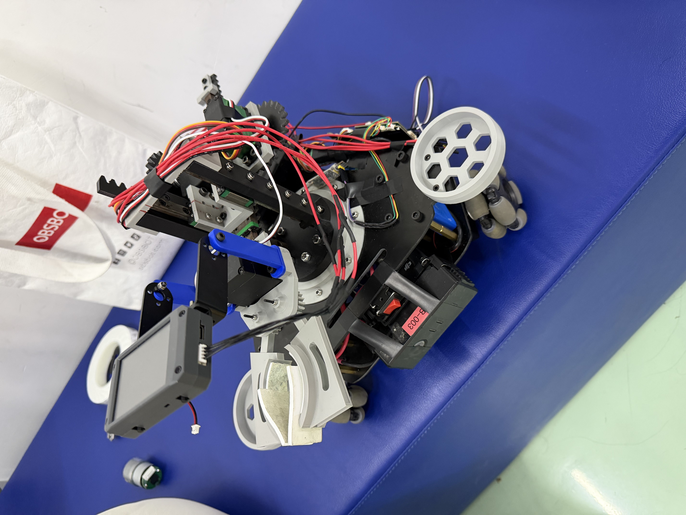
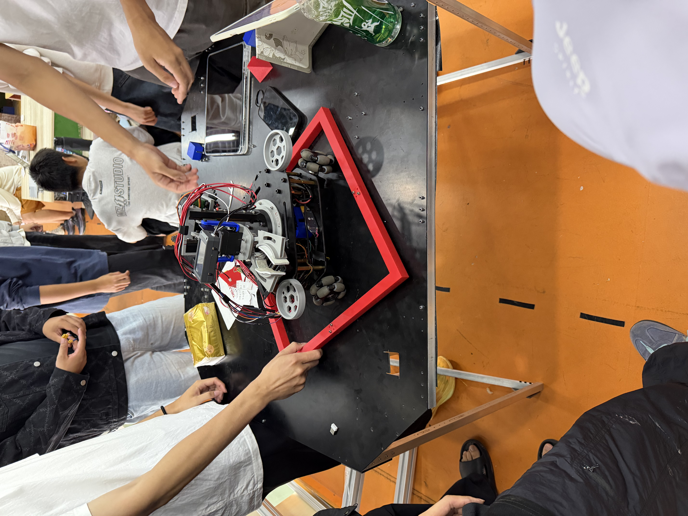

# 全向轮自动车 · 自主抓取与搬运

厦门大学机器人队自动车项目。围绕**尖朝下放置的红色三角锥**，采用全向轮底盘与自研下托合围式夹爪，实现行驶、抓取、搬运与放置的任务流程。

本仓库集中展示实机与夹爪机械设计，并提供 SolidWorks 建模资源。**夹爪机械结构由项目作者设计，控制与电控由团队另一组负责。** 团队手动车与自动车均已完成，这里展示的是自动车。

**[下载 SolidWorks 模型包](https://github.com/s13753540656-sys/auto-car-pick-and-place-/releases/tag/models-2026-11-16)** · **[模型打开教程](docs/MODELS.md)** · **[机械设计与改进方向](docs/MECHANICAL.md)** · **[控制方案说明](docs/CONTROL.md)**

<p align="center"></p>

## 项目一览

| 项目 | 内容 |
| --- | --- |
| 移动平台 | 全向轮底盘 |
| 控制平台 | STM32；具体型号和固件未随仓库提供 |
| 末端执行机构 | 自研下托合围式夹爪 |
| 抓取对象 | 红色 3D 打印三角锥，尖朝下放置 |
| 任务 | 自主行驶 → 抓取 → 搬运 → 放置 |
| 资料 | 2 张实机照片、1 段演示视频、46 个建模文件及使用说明 |
| 当前定位 | 机械作品展示与建模资料分享；尚不具备整机一键复现条件 |

## 任务与机械设计

下图为任务顺序，依据原项目说明整理，不代表仓库中已有对应控制程序。


夹爪围绕目标的摆放姿态进行设计，通过下托与合围完成抓取。结构设计重点包括：目标进入夹爪时的导向空间、闭合后的保持能力、升降过程中的间隙，以及搬运时夹爪与底盘之间的配合。具体载荷能力、容错范围、成功率和动作时间需要实测，当前没有可引用的定量结果。

照片中可观察到前部夹持结构、竖直导向结构、上部支架及整机走线。机械改进建议按“观察依据 → 需要核实的问题 → 验证方式”列于 [机械设计说明](docs/MECHANICAL.md)，不把照片观察当作尺寸或结构强度结论。

## 实机照片与演示

<p align="center"></p>

- [查看演示视频文件](auto-car-demo-720p.mp4)
- [下载 720p 演示视频](https://github.com/s13753540656-sys/auto-car-pick-and-place-/raw/refs/heads/main/auto-car-demo-720p.mp4)

若 GitHub 页面不播放视频，请下载后使用本地播放器观看。照片和视频均为仓库原有实机资料，没有使用生成图替代实物。

## 下载后如何查看模型

1. 打开 [模型 Release](https://github.com/s13753540656-sys/auto-car-pick-and-place-/releases/tag/models-2026-11-16)，在 **Assets** 中下载 `auto-car-solidworks-models-2026-11-16.zip` 及同名 `.zip.sha256` 文件。
2. 完整解压，再用兼容模型版本的 SolidWorks 打开 `二队车newnew` 文件夹内的装配体。
3. 整车装配候选文件是 `校赛新新新整车.SLDASM` 与 `整车.SLDASM`；夹爪装配是 `夹爪三_总装配.SLDASM`。最终主装配及配置需在 SolidWorks 中确认。
4. 保留零件与装配体的目录关系。如出现缺失引用，按 [模型教程](docs/MODELS.md) 排查。

资源包包含 **40 个 SLDPRT 零件、5 个 SLDASM 装配体、1 个 STEP 文件**，约 41 MB。包内有使用说明和逐文件 SHA-256 校验值。唯一 STEP 是电机模型，不能当作整车通用格式模型。

**Code → Download ZIP 只下载仓库的照片、视频、文档和脚本；CAD 包需要从 Release 单独下载。** 仓库文件名带末尾连字符，使用上方链接即可。

## 资料状态与复现边界

| 已提供 | 尚未提供或尚未核实 |
| --- | --- |
| 实机照片、演示视频 | 独立记录的抓取成功率、载荷和循环时间 |
| SolidWorks 零件及装配文件 | 在 SolidWorks 中核对完整引用、配合与版本兼容 |
| 模型清单和 SHA-256 校验 | 完整制造 BOM、材料、公差与装配工艺 |
| STM32 控制平台说明 | STM32 工程、引脚、驱动接口、接线与标定参数 |
| 控制流程设计建议 | 已验证的可烧录固件、传感器方案和调参结果 |

当前没有可直接运行或烧录的控制代码，也没有经验证的整车 STEP 导出。控制流程与后续验证建议见 [控制方案](docs/CONTROL.md)，已执行检查见 [验证记录](docs/VALIDATION.md)。

## 仓库目录

```text
README.md                        项目首页、照片、视频与模型下载入口
IMG_5779.jpeg / IMG_5788.jpeg      原始实机照片
auto-car-demo-720p.mp4            原始演示视频
docs/MODELS.md                   下载、打开、引用排查与校验教程
docs/MECHANICAL.md               机械结构说明、改进建议与测量项
docs/CONTROL.md                  控制边界、建议状态流程和接口资料
docs/VALIDATION.md               已执行检查与未验证项
models/MODEL_INDEX.json          46 个模型的文件名、大小与 SHA-256
scripts/Verify-ModelPackage.ps1   本地模型包完整性校验
LICENSE.md                       资料许可状态
```

模型大文件通过 Release 发布，避免把多份压缩包重复加入 Git 历史。修改模型后应重新核对装配引用，并创建新的模型版本与校验值。

## 许可与贡献

本仓库暂未指定覆盖全部资料的开源许可证。装配中的标准件、外购件模型可能涉及各自的来源与许可；当前没有完整的供应商来源表。使用与再分发前请阅读 [许可状态](LICENSE.md)。

欢迎通过 Issue 补充模型缺失引用、软件版本、装配错误和实测数据。修改结构或控制方案时，请同时提供变更文件、依据与验证结果，保留原始版本以便比较。
